# Llanquihue-AI: Sistema de Vigilancia y Predicción de Calidad de Aguas

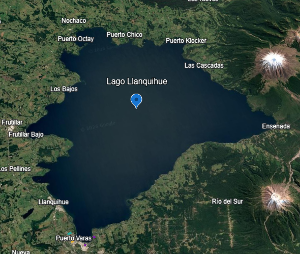

Sistema avanzado de monitoreo ambiental que utiliza imágenes satelitales Sentinel-2 (BOA) para el seguimiento del Índice de Clorofila (NDCI) en el Lago Llanquihue, Chile. El proyecto combina Big Data geoespacial, un motor de procesamiento optimizado en C++ e Inteligencia Artificial para predecir la salud del ecosistema lacustre.

## Fundamentos Científicos: ¿Qué es el NDCI?

El Normalized Difference Chlorophyll Index (NDCI) es un algoritmo espectral diseñado para estimar la concentración de clorofila-a en aguas ópticamente complejas (aguas continentales y costeras).

La FórmulaEl sistema calcula el NDCI utilizando las bandas del sensor Sentinel-2:

$$NDCI = \frac{RedEdge (B5) - Red (B4)}{RedEdge (B5) + Red (B4)}$$

Este índice es superior al NDVI tradicional en entornos acuáticos, ya que la banda RedEdge (705nm) captura con precisión la reflectancia del fitoplancton, eliminando el "ruido" del agua pura.

## Visualización Científica: Cubo Espacio-Temporal

Para el análisis de hotspots geográficos, el proyecto implementa un Space-Time Cube 3D interactivo. Esta herramienta permite:

- Eje Z (Tiempo): Apilamiento vertical de las capas anuales desde 2019 hasta 2026.

- Filtros de IA: Botones interactivos para aislar el histórico o comparar con la predicción roja de 2026.

- Referencia Geográfica: Basemap orientado (Norte-Sur / Este-Oeste) con puntos de control en Puerto Varas, Ensenada y Puerto Octay.

## Arquitectura del Proyecto

El sistema opera en cuatro fases críticas sincronizadas:

1. Extracción Geoespacial (Python & GEE): Captura de datos espectrales de alta resolución (10m) filtrando interferencias atmosféricas y nubosidad.

2. Motor de Alto Rendimiento (C++ Core): Filtrado espacial mediante kernels 3x3 e interpolación temporal para resolver vacíos de datos (gap-filling).

3. Análisis de Series Temporales (Pandas): Construcción de un dataset histórico (2019-2025) con resolución mensual.

4. Inteligencia Predictiva: Algoritmo de regresión y análisis de estacionalidad para proyectar el estado del lago a 12 meses vista.

## Resultados de la Fase de Procesamiento (2019-2025)

El sistema ha procesado exitosamente 248,868 píxeles por capa temporal. A continuación, se muestra la matriz de intensidad NDCI recuperada, donde se observan los ciclos anuales de estrés hídrico:

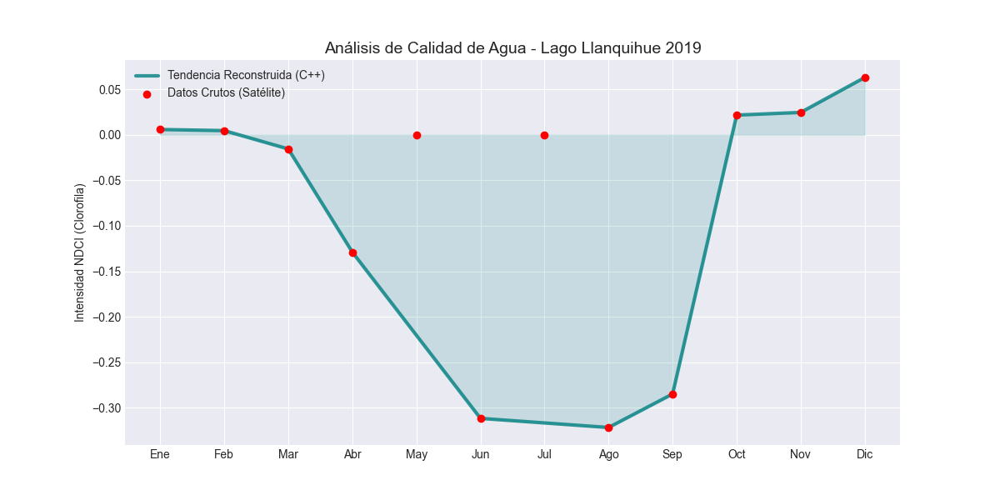

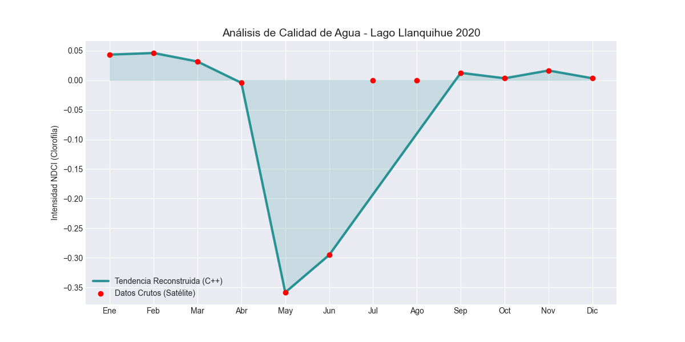

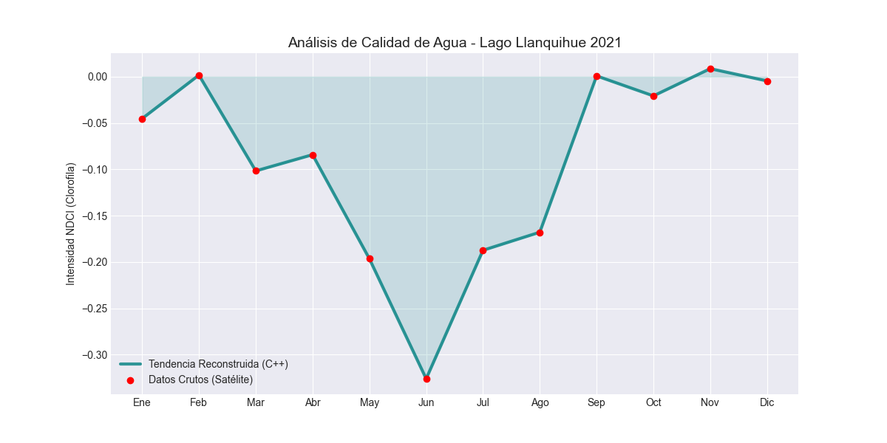

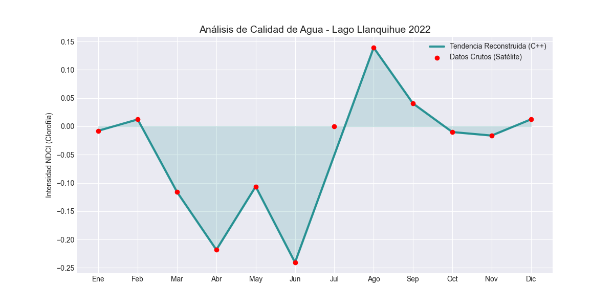

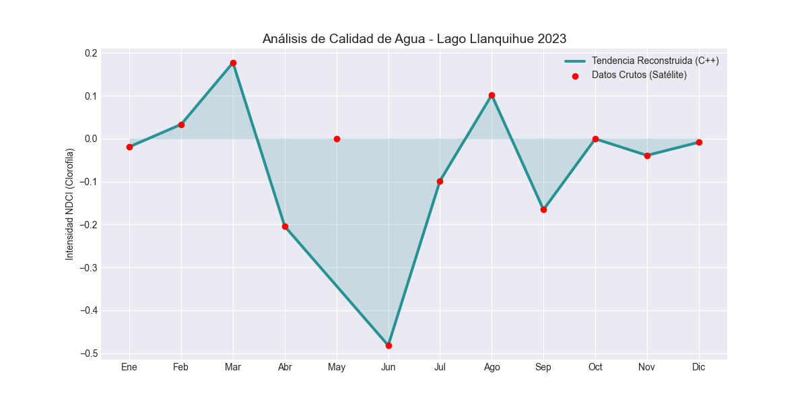

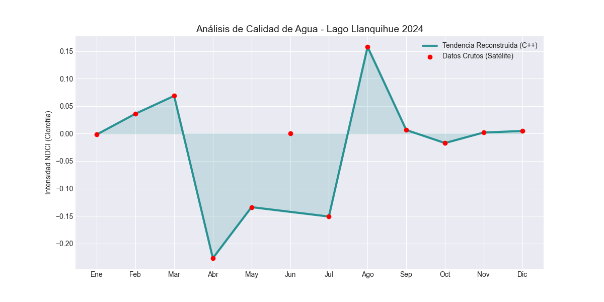

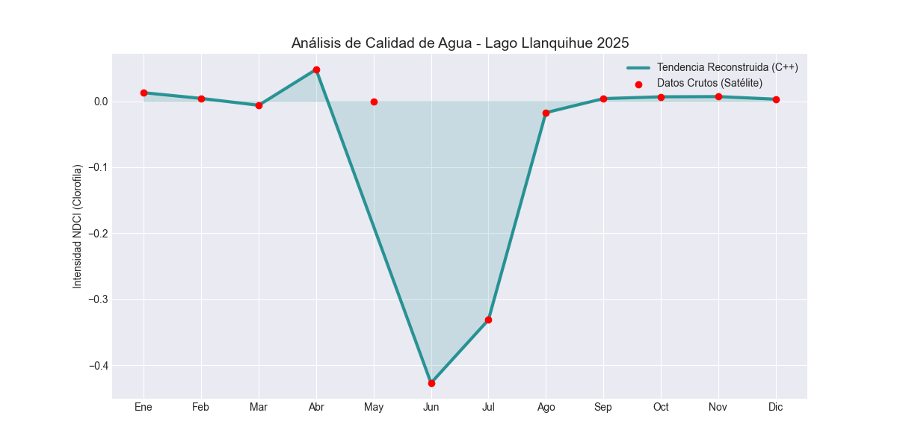

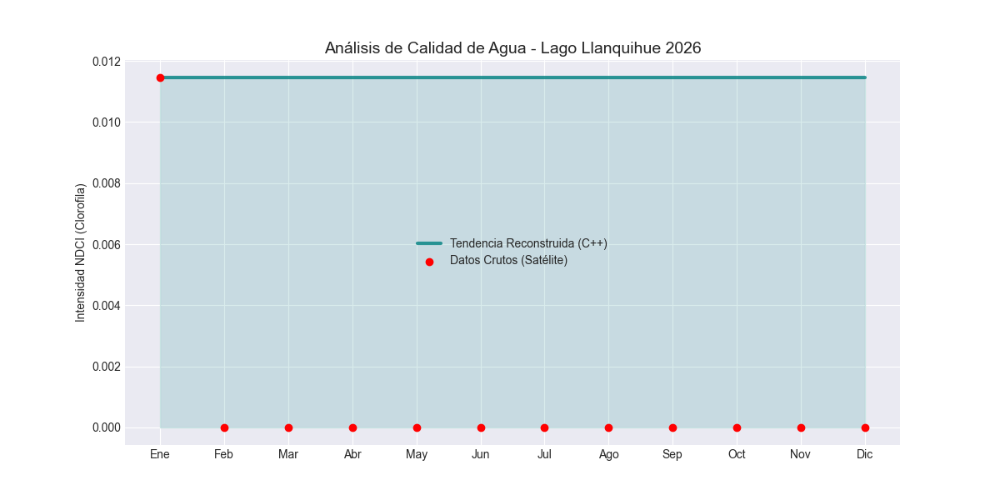

> Nota Teórica: Los valores negativos indican aguas claras (baja clorofila), mientras que valores cercanos o superiores a 0.1 NDCI activan protocolos de alerta por posible proliferación de algas.

## Análisis de la Visualización 3D
El **Cubo Espacio-Temporal** no solo es una pieza estética; es una herramienta de diagnóstico:

**1. Eje Vertical (Z):** Permite detectar la resiliencia del lago. Si cada año las manchas de color (hotspots) son más extensas, el lago está perdiendo su capacidad de autolimpieza.

**2. Variación Geográfica (X, Y):** Ayuda a localizar el origen del estrés. Si los picos de clorofila siempre nacen cerca de Puerto Varas o zonas urbanas, sugiere un impacto antrópico (humano).

**3. Tendencia IA (Capa Roja):** El modelo predice si la inercia actual del ecosistema nos llevará a cruzar el umbral crítico de 0.1 en el próximo ciclo estacional.

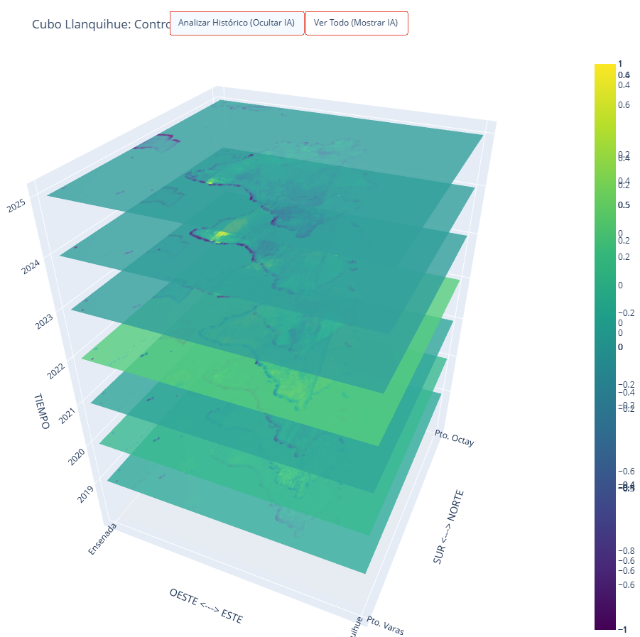

## Interpretación de Niveles y Umbrales

El gráfico y el cubo 3D representan la salud del lago según los siguientes rangos de valor:

**Dinámica de Valores:**

- **¿Qué pasa si el NDCI sube?** Indica una proliferación de algas (eutrofización). Esto suele ocurrir por el aumento de la temperatura del agua en verano o el vertido de nutrientes (fósforo/nitrógeno). Un NDCI alto sostenido puede llevar a la hipoxia (muerte de peces).

- **¿Qué pasa si el NDCI baja?** Significa que el agua está recuperando su transparencia. En invierno, es normal ver valores muy bajos (incluso negativos) debido a la menor radiación solar y menor actividad biológica.

## Proyección IA 2026

Basado en el entrenamiento histórico, el modelo proyecta una tendencia estable para el año 2026:

- **Estado Promedio:** ~ -0.040 NDCI.

- **Diagnóstico:** Recuperación progresiva y estabilidad en los niveles de clorofila.

- **Alertas:** No se detectan anomalías críticas para el primer semestre de 2026 bajo el modelo de tendencia actual.

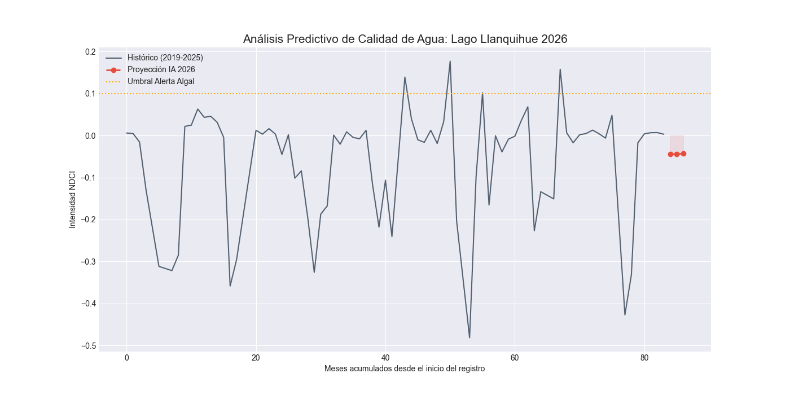

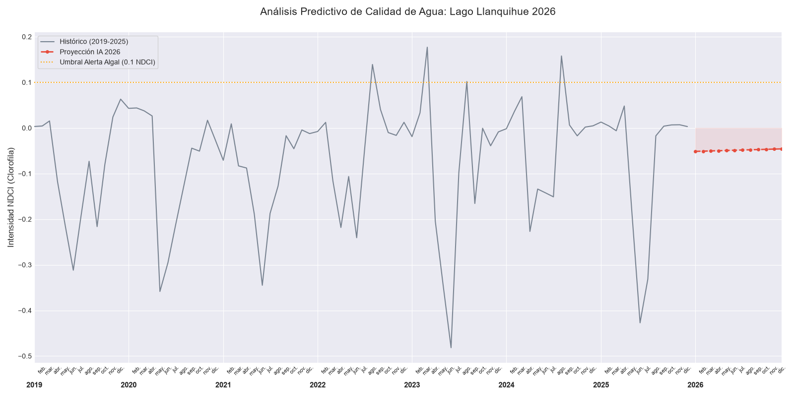

## Instalación y Requisitos

1. Python 3.10+: 

``uv sync``

2. C++ Compiler: Requiere g++ (v11+) para compilar el engine_core.

``uv run setup_engine.py``

3. Google Earth Engine: Requiere cuenta activa y autenticación mediante earthengine authenticate.

---
## Uso del Sistema
Para correr el programa principal:
``uv run main.py``
